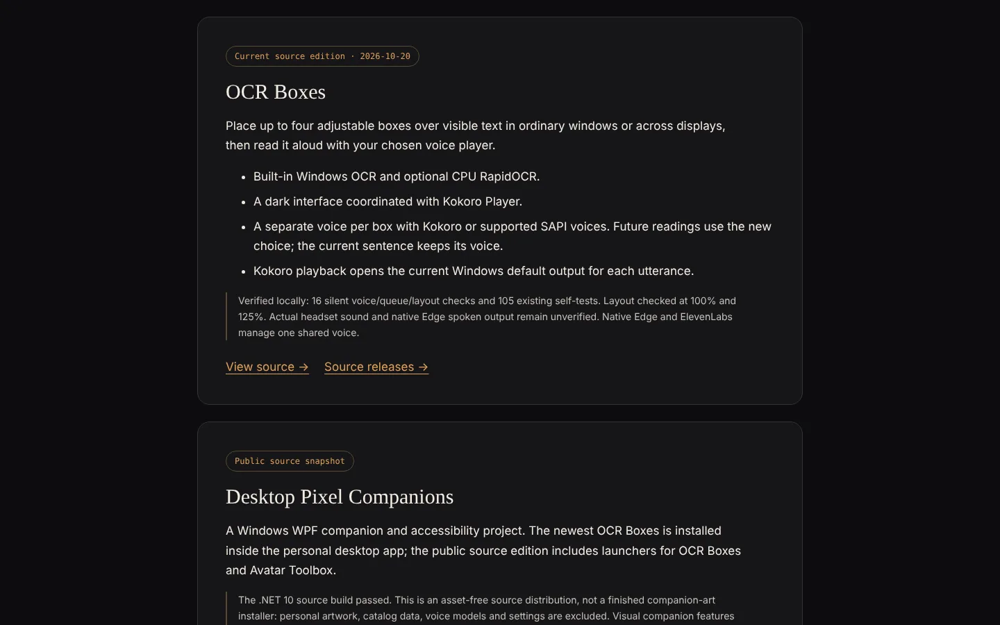

# OCR Boxes

**Read visible text on your screen aloud with adjustable OCR boxes.**

[**▶ Project page on caseyshingledecker.com**](https://caseyshingledecker.com/desktop-tools.html#ocr-boxes) · [**Source**](https://github.com/Beebopcat/ocr-boxes)



## What it is

A Windows desktop OCR and text-to-speech tool. Place up to four adjustable boxes over visible text, in ordinary windows or across displays, and have it read aloud with a voice player you choose. Windows OCR is built in; CPU RapidOCR is optional. The application starts stopped.

## Screenshots


<sub>Desktop Tools page scrolled to the OCR Boxes card, with its description, feature bullets and verification notes.</sub>

## How to use

1. Requires Windows 10/11 and AutoHotkey v2, installed from its official site. Keep the three folders together.
2. Run `OcrBoxes/OCR Boxes.ahk`. The application starts stopped.
3. Use **+** or **Fit box to window / display**, position the box over the text you want read, lock it, and press **Play**.
4. Optional: run `Setup-RapidOCR.ps1` in PowerShell to configure CPU RapidOCR. It uses an existing Python installation to create a local virtual environment and installs the declared PyPI requirements. It does not download Python or AutoHotkey.
5. Kokoro playback needs your own running, compatible local service at 127.0.0.1:8787.

## Features

- Up to four adjustable OCR boxes over visible text (fixed visible screen areas, not background or window-tracking capture)
- Built-in Windows OCR plus optional CPU RapidOCR
- General window and display capture, independent of game profiles
- A separate voice for each OCR box while retaining the selected player. Kokoro and allowed installed SAPI voices expose per-box choices. A change applies to future utterances; the current sentence keeps its voice
- Kokoro playback opens the current Windows default output for each utterance. No voice models or cloned voices are included
- Optional native Edge Read Aloud, adapted from Game Voice Reader's approach, without MB5. It requires explicit focus consent and uses one shared browser-managed voice
- Dark charcoal interface matched to Kokoro Player; control layout checked at 96 and 120 DPI

## The story behind it

The current source edition is dated 2026-10-20. OCR Boxes grew out of a local Game Voice Reader AutoHotkey tool and is bundled inside Desktop Pixel Companions, where the newest OCR Boxes is installed. Casey built it with AI-assisted development, testing and independent code review.

## Built with

- AutoHotkey v2
- Windows OCR (Descolada OCR library, MIT, based on malcev's UWP work)
- RapidOCR (CPU, optional, via a local Python virtual environment)
- Kokoro TTS service at 127.0.0.1:8787 (bring your own)
- SAPI voices
- Native Edge Read Aloud (informed by KnightDevRedEmber/GameVoiceReader, MIT)

## Run it locally

Requires Windows 10/11 and AutoHotkey v2. Clone the repository, keep the folders together, and run `OcrBoxes/OCR Boxes.ahk`.

```powershell
git clone https://github.com/Beebopcat/ocr-boxes.git
```

The source package excludes personal settings, game inventory, captured text, logs, model weights and character artwork. Guarded game configuration must be supplied and verified separately.

## Validation

16 silent per-box/queue/layout checks and 105 existing self-tests passed on the author's Windows PC. Actual headset sound and native Edge speech have not been independently verified. Tests do not establish compatibility with every display, game or voice service.

## Credits & disclaimers

The Windows OCR library is by Descolada (MIT), based on malcev's UWP work. The native Edge workflow was informed by KnightDevRedEmber/GameVoiceReader (MIT). Full notices are in `notices/`. Runtime packages retain their own licenses.
Casey's original project source is published for inspection; no additional license for that source or third-party artwork/models is granted by this repository.

Built by Casey Shingledecker with AI-assisted development.

## More projects

- Portfolio and live demos: https://caseyshingledecker.com/
- All repositories: https://github.com/Beebopcat

## License

Copyright (c) 2026 Casey Shingledecker. All rights reserved. Source-available for viewing and for personal, non-commercial running only; this is not open source. See [LICENSE](LICENSE). Other people's material keeps its own license; see [THIRD-PARTY-NOTICES.md](THIRD-PARTY-NOTICES.md).
